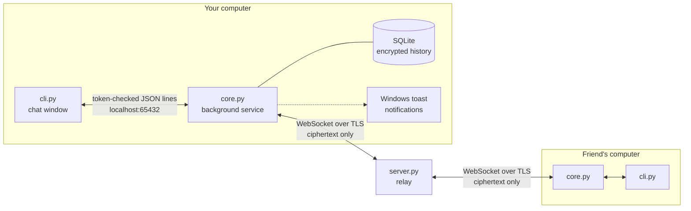

# 💬 Yakishi Terminal Chat

**Encrypted chat that lives in your terminal, with a background service that never misses a message.**

Type `TerminalChat` in any terminal, pick a contact and start talking. Messages are encrypted on your own computer before they leave it, stored locally as encrypted history, and when the chat window is closed a background service still receives messages and shows a Windows notification.


---

## Highlights

- **Encrypted on your machine**: messages, sender names and colors are encrypted with a key derived from a password you share with your contact; the relay server only ever forwards ciphertext
- **Hardened by design**: slow, salted key derivation, a locked local service, contacts protected by Windows DPAPI, replay protection and terminal-safe output (see *Security*)
- **Always on**: a windowless background service starts with Windows, stays connected and keeps receiving messages even when no chat window is open
- **Desktop notifications** for new messages while the chat window is closed
- **History**: every conversation is saved locally in SQLite, still encrypted, and shown when you reopen the chat
- **Works offline gracefully**: the service reconnects by itself, waiting longer between attempts while the network is down
- **One-command install**: a setup script installs dependencies, registers the service and puts `TerminalChat` on your PATH
- **Personal touch**: choose your display name and color

## Architecture

The app is split into three programs that each do one job.



| Part | Role |
|---|---|
| **`client/cli.py`** | The chat window you type in. Menus for contacts, adding a contact, profile settings and the chat itself. It talks only to the local core service, proving itself with a secret token the core writes at startup. Contacts and their passwords are stored encrypted with Windows DPAPI. Incoming text is stripped of terminal control sequences before it is printed. If the service isn't running, it starts it silently and waits with a small animation. |
| **`client/core.py`** | The background service (runs with `pythonw`, no window). Holds the connection to the relay, encrypts and decrypts messages, writes history to SQLite, and shows a notification when a message arrives while the chat window is closed. Listens for the chat window only on `127.0.0.1` and only accepts a window that presents its token, so neither the network nor other local programs can read or send messages through it. |
| **`client/setup.py`** | Installer: installs the libraries, copies the client to `%LOCALAPPDATA%\Yakishi\Terminal_Chat`, creates the database and profile files, adds the core service to Windows startup and puts a `TerminalChat` launcher on your PATH. |
| **`server.py`** | A small asyncio WebSocket relay. It forwards each encrypted packet to the other members of the same room and never sees plain text, names or keys. It validates packets, rate-limits each connection and answers plain HTTP health checks, which hosting platforms such as Render send to see whether a service is alive. |

### How a message travels

1. You and your friend add each other with the **same room password**.
2. When you open the chat, the core runs the password through **scrypt** (a deliberately slow, memory-hard key-derivation function) and splits the result into an **encryption key** and a **room ID**. The password never leaves your computer.
3. The core joins the room on the relay over a TLS-encrypted WebSocket.
4. You type a message. The core puts your name, color and text in one JSON object, encrypts it with **Fernet** (AES-128-CBC with an HMAC-SHA256 authentication tag, from the `cryptography` library) and sends only the ciphertext.
5. The relay forwards it to the other members of the room.
6. Your friend's core rejects anything that fails authentication, is older than 10 minutes or was already seen, decrypts the rest, saves it to history and either shows it in the chat window or pops up a notification.

## Getting started (Windows)

### Client

```bash
cd client
python setup.py
```

Enter a display name when asked. After setup, open any terminal and type:

```bash
TerminalChat
```

- **Rehber**: choose a contact and start chatting
- **Yeni Kişi/Oda Ekle**: add a contact with a name and a shared password of at least 12 characters (your friend must use the same one). Leave the password empty and the app generates a strong one for you to pass on through another channel
- **Profil Ayarları**: change your name and color (RED, GREEN, YELLOW, BLUE, CYAN, MAGENTA)
- Type `-exit` to leave a chat

### Relay server

```bash
pip install -r requirements.txt
python server.py          # listens on $PORT, default 10000
```

It runs on any host with WebSocket support, including Render's free tier. Set `RELAY_URL` at the top of `client/core.py` to your relay's `wss://` address.

## Project structure

```
├── server.py          # WebSocket relay
├── requirements.txt   # Relay dependency: websockets
└── client/
    ├── setup.py       # Installer
    ├── core.py        # Background service: relay connection, crypto, history, notifications
    └── cli.py         # Chat window
```

The interface text is in Turkish.

## Security

| Threat | Protection |
|---|---|
| Someone reads the traffic | TLS on the WebSocket, and every message is end-to-end encrypted with Fernet |
| The relay operator or a spy on the relay | Sees only ciphertext and a room ID; names, colors and text are inside the encryption |
| Guessing the password from the room ID | Room ID and key both come from scrypt (N=2^15, r=8), so every guess is slow; passwords must be 12+ characters or generated |
| Forged, altered or replayed messages | Fernet authentication tag, 10-minute freshness window, and duplicate detection in the local history |
| Other programs on the same PC | The local service only answers a window that presents its secret token; the port is bound exclusively |
| Stolen contact list | Contacts are encrypted with Windows DPAPI, tied to your Windows account |
| Malicious text in messages | Terminal escape codes, control characters and bidirectional-override characters are removed before printing |
| Flooding | Packet size limits and per-connection rate limits on the relay |

This is a personal project and has not been independently audited. Anyone who knows a room's password can read that room and write in it, so share passwords privately.

## Roadmap

- [ ] Per-device keys and forward secrecy (a Double Ratchet style protocol)
- [ ] Offline delivery: keep encrypted messages on the relay until the recipient comes online
- [ ] Linux and macOS support (startup entry, notifications, app folder)
- [ ] An uninstaller
